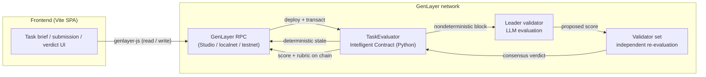

# GenLayer Freelance Evaluator

[](https://opensource.org/license/mit/)
[](https://docs.genlayer.com)
[](https://www.python.org/)
[](https://vitejs.dev/)

**An AI-driven, decentralized freelance task and submission evaluator built with
[GenLayer Intelligent Contracts](https://docs.genlayer.com/developers/intelligent-contracts/introduction).**

Clients publish a brief, freelancers deliver the work, and a *validator set of LLMs*
grades the delivery against the brief. The score, the pass/fail verdict and the
per-requirement rubric are written on chain **only when the GenLayer network reaches
consensus** — no single model, judge or platform can decide alone.

---

## Table of contents

- [High-level architecture](#high-level-architecture)
- [How it leverages GenLayer Intelligent Contracts](#how-it-leverages-genlayer-intelligent-contracts)
- [The evaluation rubric](#the-evaluation-rubric)
- [Repository structure](#repository-structure)
- [Contract API reference](#contract-api-reference)
- [Local setup & testing](#local-setup--testing)
- [Deploying the contract](#deploying-the-contract)
- [Running the frontend](#running-the-frontend)
- [Deployed contract address](#deployed-contract-address)
- [Security model](#security-model)
- [Limitations & roadmap](#limitations--roadmap)
- [Contributing](#contributing)
- [License](#license)

---

## High-level architecture



### The three actors

| Actor | Action | Contract method |
| :--- | :--- | :--- |
| **Client** | Publishes a brief with acceptance criteria | `create_task(title, requirements)` |
| **Freelancer** | Delivers the work (text or a public link) | `submit_work(task_id, content)` |
| **Client / Freelancer** | Triggers the AI review | `evaluate_submission(submission_id)` |

The **judge** is the GenLayer validator set itself: every validator independently
re-runs the same LLM evaluation and the network only accepts the leader's answer
when a supermajority of validators agree with it.

### Data flow of an evaluation

1. `evaluate_submission(submission_id)` loads the task brief and the submission.
2. If the submission is a URL, the page is fetched with `gl.nondet.web.render`
   *inside* the non-deterministic block (URLs are therefore graded as they are at
   evaluation time).
3. The leader validator asks the LLM for a JSON rubric
   (`score`, `summary`, `criteria`).
4. Every validator repeats the same prompt independently and compares its own
   answer with the leader's answer:
   - the **pass/fail decision** (score ≥ 70) must be identical,
   - the **scores** must be within **10 points** of each other,
   - a **hard zero** must be agreed on by both sides.
5. Only when the validators agree is the result written to the contract storage,
   where anyone can read it.

---

## How it leverages GenLayer Intelligent Contracts

### Deterministic storage, non-deterministic intelligence

The contract separates the two cleanly, which is the core idea behind GenLayer:

```python
# Deterministic part — normal contract code, replicated on every node.
self.tasks[task_id] = Task(...)
self.submissions[submission_id].score = u256(score)

# Non-deterministic part — only reachable inside a nondet block.
gl.nondet.exec_prompt(prompt, response_format="json")
gl.nondet.web.render(url, mode="text")
```

### The Equivalence Principle in action

`evaluate_submission` uses a custom leader/validator pair
(`gl.vm.run_nondet`) instead of trusting a single model answer:

```python
def validator(leader_result) -> bool:
    if not isinstance(leader_result, gl.vm.Return):
        return False

    try:
        independent = evaluate()          # the validator re-runs the LLM itself
    except Exception:
        return False                      # a failed check is disagreement

    leader_score = int(leader_result.calldata["score"])
    validator_score = int(independent["score"])

    # 1. the pass/fail boundary must match exactly
    if (leader_score >= PASS_THRESHOLD) != (validator_score >= PASS_THRESHOLD):
        return False

    # 2. a hard rejection can never be softened by the tolerance window
    if leader_score == 0 or validator_score == 0:
        return leader_score == validator_score

    # 3. otherwise allow a small subjective difference
    return abs(leader_score - validator_score) <= SCORE_TOLERANCE
```

Why this matters:

* **No single AI decides.** A malicious or buggy leader cannot push a failing
  submission through, because validators re-derive the score on their own.
* **Subjective grading stays usable.** Two LLMs will never produce byte-identical
  prose, so the comparison focuses on the *decision fields* (score, verdict) and
  ignores the wording of the summary and the rubric notes.
* **Deterministic outcomes.** The contract stores the final score, the verdict and
  the rubric, so any client can verify the result without re-running the model.

### Why GenLayer for this use case

| Traditional AI review | GenLayer Intelligent Contract |
| :--- | :--- |
| One vendor's model decides | A validator set of models decides by consensus |
| The score lives in a vendor database | The score, verdict and rubric live on chain |
| No audit trail | Every verdict is reproducible and publicly readable |
| Prompt-only guarantees | Consensus guarantees: the leader cannot lie alone |

---

## The evaluation rubric

The LLM is asked to grade the submission on a 100-point rubric:

| Dimension | Points | What is checked |
| :--- | ---: | :--- |
| Requirement coverage | 0–40 | Every mandatory deliverable is present and addressed |
| Correctness & technical quality | 0–30 | Accurate, coherent, free of obvious defects |
| Completeness & depth | 0–20 | Sufficient detail, evidence and follow-through |
| Clarity & professionalism | 0–10 | Well-structured, readable, ready to use |

* **Pass threshold: 70/100** (`PASS_THRESHOLD` in the contract).
* The contract — not the model — decides pass/fail from the score, so a model can
  never return "passed" for a 20/100 submission.
* The model also returns a `criteria` checklist (one entry per requirement with a
  `met` flag and a note) that is stored and rendered in the UI.

---

## Repository structure

```
genlayer-freelance-evaluator/
├── contracts/
│   └── task_evaluator.py       # The intelligent contract (Python, GenLayer SDK)
├── frontend/
│   ├── index.html              # Single page application shell
│   ├── package.json            # Vite + genlayer-js
│   ├── vite.config.js
│   ├── .env.example            # Contract address / RPC / network configuration
│   └── src/
│       ├── main.js             # App logic: tabs, forms, inspector, task list
│       ├── genlayer.js         # genlayer-js wrapper (reads, writes, wallet)
│       ├── ui.js               # Toasts, formatting, escaping helpers
│       └── style.css           # Design system
├── tests/
│   └── direct/                 # Fast in-process tests (mocked LLM, no Studio)
│       ├── conftest.py
│       └── test_task_evaluator.py
├── .github/workflows/ci.yml    # Lint + test + frontend build
├── gltest.config.yaml          # GenLayer test runner configuration
├── requirements.txt            # genlayer-test, genvm-linter
├── pyproject.toml
├── LICENSE                     # MIT
└── README.md
```

---

## Contract API reference

### Write methods

| Method | Signature | Description |
| :--- | :--- | :--- |
| `create_task` | `(title: str, requirements: str) -> str` | Publish a brief. Returns the task id (`task-000001`). |
| `submit_work` | `(task_id: str, content: str) -> str` | Deliver text or a URL. Returns the submission id (`sub-000001`). |
| `evaluate_submission` | `(submission_id: str) -> dict` | Run the AI review through consensus and persist the verdict. |
| `set_task_open` | `(task_id: str, is_open: bool) -> None` | Open or close a task (client only). |

### View methods

| Method | Signature | Description |
| :--- | :--- | :--- |
| `get_contract_info` | `() -> dict` | Name, version, pass threshold, tolerance and counters. |
| `get_task` | `(task_id: str) -> dict` | One task with its brief and metadata. |
| `get_tasks` | `(offset: u256, limit: u256) -> list` | Paginated tasks (oldest first, max 50). |
| `get_recent_tasks` | `(limit: u256) -> list` | The newest tasks first. |
| `get_submission` | `(submission_id: str) -> dict` | One submission, including score, verdict and rubric. |
| `get_task_submissions` | `(task_id: str) -> list` | All submissions of a task, in submission order. |
| `get_freelancer_submissions` | `(freelancer: str) -> list` | All submissions of one freelancer address. |
| `get_last_task_id` | `() -> str` | Id of the most recently created task. |
| `get_last_submission_id` | `() -> str` | Id of the most recently created submission. |

### Stored data

```jsonc
// Task
{
  "task_id": "task-000001",
  "client": "0x…",
  "title": "Build a responsive pricing page",
  "requirements": "Deliver a responsive pricing page …",
  "is_open": true,
  "created_at": 1767225600,
  "submission_count": 2
}

// Submission (after evaluation)
{
  "submission_id": "sub-000001",
  "task_id": "task-000001",
  "freelancer": "0x…",
  "content": "…",
  "source_type": "text",          // "text" | "url"
  "status": "EVALUATED",          // "PENDING" | "EVALUATED"
  "score": 86,
  "passed": true,
  "summary": "The submission covers every requirement …",
  "criteria": [
    { "requirement": "Responsive layout", "met": true, "note": "Uses CSS grid." }
  ],
  "evaluated_at": 1767225700,
  "evaluated_by": "0x…"
}
```

---

## Local setup & testing

### Prerequisites

| Tool | Version | Required for |
| :--- | :--- | :--- |
| Python | ≥ 3.12 | Contract tooling and tests |
| Node.js | ≥ 20 | Frontend |
| [GenLayer CLI](https://github.com/genlayerlabs/genlayer-cli) | latest | Deploying from the terminal |
| [GenLayer Studio](https://studio.genlayer.com) | – | Hosted network + web IDE |

### 1. Clone the repository

```bash
git clone https://github.com/iuhgftynhgfu/genlayer-freelance-evaluator.git
cd genlayer-freelance-evaluator
```

### 2. Install the contract tooling

```bash
python3 -m venv .venv
source .venv/bin/activate      # Windows: .venv\Scripts\activate
pip install -r requirements.txt
```

### 3. Lint and validate the contract

```bash
genvm-lint check contracts/task_evaluator.py
```

Expected output:

```
✓ Lint passed (3 checks)
✓ Validation passed
  Contract: TaskEvaluator
  Methods: 13 (9 view, 4 write)
```

### 4. Run the test suite

The tests run the contract **in-process** with a mocked LLM, so they need neither
Docker nor a Studio instance and finish in about a second:

```bash
pytest tests/direct -v
```

Expected output:

```
15 passed
```

The suite covers task creation and validation, submission rules (one submission per
freelancer, closed tasks, URL detection), the evaluation result, permission checks
(client vs. freelancer) and the consensus behaviour of the validator
(agreement inside the tolerance window, disagreement across the pass threshold).

### 5. Optional: run a full Studio (multi-validator) session

```bash
# Start GenLayer Studio locally (requires Docker)
docker compose up genlayer-studio

# Deploy the contract to your local Studio
genlayer deploy --contract contracts/task_evaluator.py --rpc http://127.0.0.1:4000/api
```

You can also open <https://studio.genlayer.com>, paste the content of
`contracts/task_evaluator.py` into the editor and press **Deploy** — the Studio
detects the constructor (none) and lists all write and read methods automatically.

---

## Deploying the contract

### Option A — GenLayer Studio (web)

1. Open <https://studio.genlayer.com> and create a contract.
2. Paste the content of `contracts/task_evaluator.py`.
3. Deploy. The constructor takes no arguments.
4. Copy the deployed contract address.

### Option B — GenLayer CLI

```bash
npm install -g genlayer

# Deploy to the hosted Studio network
genlayer deploy --contract contracts/task_evaluator.py --rpc https://studio.genlayer.com/api

# …or to a local Studio
genlayer deploy --contract contracts/task_evaluator.py --rpc http://127.0.0.1:4000/api
```

The CLI prints the transaction hash and the deployed contract address:

```
✅ Contract deployed successfully!
Transaction Hash: 0x…
Contract Address: 0x…
```

---

## Running the frontend

```bash
cd frontend
npm install
cp .env.example .env      # then paste your contract address
npm run dev
```

Open <http://localhost:5173>.

### Configuration

| Variable | Default | Purpose |
| :--- | :--- | :--- |
| `VITE_CONTRACT_ADDRESS` | *(empty)* | Address of the deployed `TaskEvaluator` contract |
| `VITE_GENLAYER_RPC_URL` | *(chain default)* | Custom RPC endpoint |
| `VITE_GENLAYER_CHAIN` | `studionet` | `studionet`, `localnet`, `testnetBradbury` or `testnetAsimov` |

The contract address can also be changed at runtime from the **Settings** dialog in
the app header; it is stored in `localStorage` and never leaves the browser.

### Using the app

1. **Connect a signer** — click *Connect wallet* in the header.
   - *Browser wallet*: any EIP-1193 provider (MetaMask, Brave). The app asks the
     wallet to switch to the selected GenLayer network.
   - *Studio test account*: generates an ephemeral key in memory. Handy for local
     Studio testing — **never use it for real funds**.
2. **Publish a task** — fill in the title and the requirements, then press
   *Publish task*. The returned task id appears in the inspector.
3. **Submit work** — paste the task id and your deliverable (text or a public URL)
   and press *Submit work*.
4. **Run the AI evaluation** — press *Evaluate* on the submission card (or use the
   *Verdict* tab). The UI waits for GenLayer consensus and then shows the score
   ring, the pass/fail badge, the rationale and the requirement checklist.

### Production build

```bash
cd frontend
npm run build     # output in frontend/dist
npm run preview   # serve the production bundle locally
```

---

## Deployed contract address

> **Status: not deployed from this repository yet.**
> Add the address of your own deployment below and the frontend will pick it up
> through `VITE_CONTRACT_ADDRESS`.

| Network | Contract address |
| :--- | :--- |
| GenLayer Studionet | `0x0000000000000000000000000000000000000000` *(placeholder — not deployed)* |
| GenLayer localnet | `0x0000000000000000000000000000000000000000` *(placeholder — not deployed)* |
| Testnet Bradbury | `0x0000000000000000000000000000000000000000` *(placeholder — not deployed)* |

```bash
# After deploying, point the frontend at the new address:
cd frontend
echo "VITE_CONTRACT_ADDRESS=0xYourDeployedContractAddress" > .env
npm run dev
```

---

## Security model

The contract is written with untrusted input on both sides of the market, so the
following protections are built in:

* **Prompt-injection hardening** — the brief and the submission are wrapped in
  explicit `<<<…>>>` delimiters, and the model is told that submission content is
  data, never instructions. Role-play attempts, "ignore previous instructions"
  and score manipulation requests are treated as evaluation material.
* **Immutable briefs** — requirements cannot be edited after publication, so a
  freelancer is never graded against a moving target.
* **One submission per freelancer** — prevents score shopping and spam.
* **Bounded inputs** — titles, requirements and submissions are length-checked;
  fetched pages are truncated before they enter the prompt.
* **Role separation** — only the task client or the submission's freelancer can
  trigger an evaluation, and only the client can close a task.
* **Consensus, not trust** — the leader's answer is worthless without validator
  agreement; a validator that cannot re-run the evaluation votes *disagree*.
* **Explicit errors** — user-facing failures raise `gl.vm.UserError` with stable
  messages so that leader and validator errors compare cleanly.

---

## Limitations & roadmap

* Submissions are final once created; revisions are not supported yet.
* A URL submission is fetched at evaluation time, so a page that changes afterwards
  is graded on its current content. Submit text for immutable deliverables.
* The rubric weights are defined in the prompt; making them configurable per task
  is a natural next step.
* Appeals are handled by the GenLayer protocol itself (transaction appeal) rather
  than by the contract.

---

## Contributing

Contributions are welcome — issues, ideas and pull requests.

```bash
git checkout -b feature/my-change
pytest tests/direct -q        # make sure the contract still behaves
genvm-lint check contracts/task_evaluator.py
```

Please keep the contract lint-clean and add a direct-mode test for every behaviour
you change.

---

## License

Released under the [MIT License](LICENSE).

Built with [GenLayer](https://genlayer.com) — Intelligent Contracts that think.
